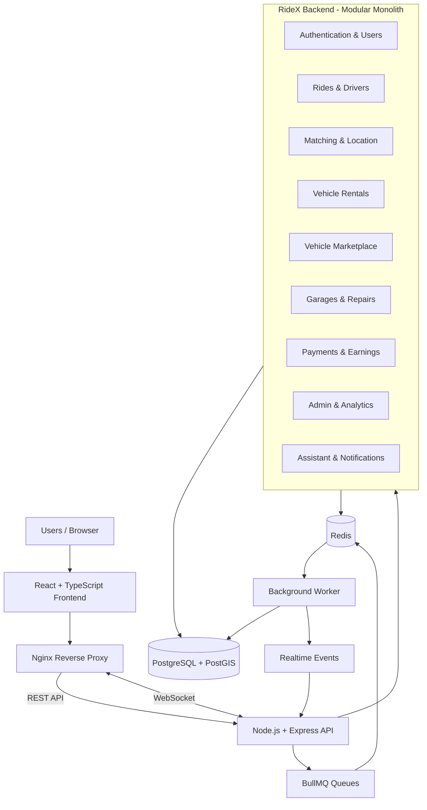

# 🚗 RideX — Unified Mobility Ecosystem

### One Platform. Every Mobility Need.

**RideX** is an all-in-one mobility platform designed to connect ride-hailing, vehicle rentals, pre-owned vehicle trading, and garage services under a single ecosystem.

## 🚩 Problem Statement

Most mobility platforms focus on a single service, such as booking rides or renting vehicles. Users often need multiple applications to manage transportation, vehicle purchases, rentals, and maintenance, resulting in a fragmented experience.

## 💡 Our Solution

RideX brings these services together through a unified, role-based platform where users can book rides, rent vehicles, explore pre-owned vehicles, and find trusted garage services.

It also provides dedicated workflows for drivers, vehicle owners, sellers, mechanics, and administrators.

## ✨ Key Features

- 🚕 **Smart Ride-Hailing:** Ride booking, fare estimation, nearby driver matching, live tracking, and ride management.
- 🚘 **Vehicle Rentals:** Vehicle listings, rental bookings, availability management, and return workflows.
- 🛒 **Vehicle Marketplace:** Buy and sell pre-owned vehicles, make offers, and access inspection reports.
- 🔧 **Garage Services:** Discover garages, book repairs, assign mechanics, and track maintenance.
- 💳 **Unified Payments:** Payment workflows, refunds, commissions, and earnings management.
- 📍 **Smart Location Services:** Geospatial searches, driver discovery, and route estimation.
- ⚡ **Real-Time Communication:** Live updates, notifications, and background job processing.
- 🧠 **AI-Powered Assistant:** Multilingual English/Hindi assistance and voice-based accessibility.
- 📊 **Admin Dashboard:** Platform monitoring, analytics, and operational management.

## 🌍 Supporting the Wider Mobility Ecosystem

RideX is designed as an extensible foundation for other mobility businesses. Its modular backend and API-driven architecture make it possible to integrate individual services into existing mobility applications.

Businesses can adapt ride-booking, rental, marketplace, garage, payment, and location modules instead of building every workflow from scratch.

## 🏆 What Makes RideX Different?

Unlike conventional ride-booking platforms that primarily focus on connecting riders and drivers, RideX connects multiple stages of the vehicle and mobility lifecycle within one ecosystem.

Its engineering foundation includes:

- Redis GEO for efficient nearby-driver discovery.
- PostgreSQL and PostGIS for persistent geospatial data.
- Socket.IO for real-time communication.
- BullMQ and Redis for asynchronous background processing.
- Database transactions, constraints, and idempotency for safer concurrent operations.
- Modular Monolith Architecture for maintainability and future scalability.

## 🏗️ Technology Stack

| Layer | Technologies |
|---|---|
| Frontend | React, TypeScript |
| Backend | Node.js, Express.js |
| Database | PostgreSQL, PostGIS |
| Caching & Queues | Redis, BullMQ |
| Real-Time | Socket.IO |
| Infrastructure | Docker, Docker Compose, Nginx |

## 🧩 System Architecture

RideX follows a **Modular Monolith Architecture**. The backend is organized into independent business modules within a single API application, while background processing runs through a separate worker process.

### Architecture Diagram



### ⚙️ How the Architecture Works

1. **Frontend Layer:** React and TypeScript provide interfaces for riders, drivers, vehicle owners, buyers, sellers, and administrators.
2. **API Layer:** Node.js and Express handle authentication, validation, business logic, and REST API requests.
3. **Business Modules:** Independent domain modules handle rides, matching, rentals, marketplace, garages, payments, and analytics.
4. **Database Layer:** PostgreSQL stores application data, while PostGIS supports location-based queries.
5. **Caching Layer:** Redis manages frequently changing driver locations, caching, and queue storage.
6. **Background Processing:** BullMQ schedules asynchronous tasks, which are processed by independent workers.
7. **Real-Time Layer:** Socket.IO delivers live ride updates, location changes, and communication events.

### 🔄 Request Processing Flow

```text
       User Request
            |
            v
     React Frontend
            |
            v
     Nginx Reverse Proxy
            |
            v
      Express Routes
            |
            v
        Controllers
            |
            v
         Services
            |
            v
       Repositories
            |
            v
    PostgreSQL / PostGIS

  Asynchronous Processing:
  
    API -> BullMQ -> Redis
                       |
                       v
                Background Worker
                       |
                       v
            Notifications / Expiry /
               Maintenance Jobs

  Real-Time Communication:

    API <---- Socket.IO ----> Clients
```

### 📦 Core Backend Modules

- Authentication & User Management
- Rider & Driver Management
- Vehicle Management
- Ride Booking & Pricing
- Driver Matching & Location
- Route Estimation
- Vehicle Rentals
- Pre-Owned Vehicle Marketplace
- Garage & Repair Management
- Payments & Earnings
- Notifications & Chat
- Maintenance & Support
- AI Assistant
- Admin & Analytics

### 🗄️ Infrastructure Responsibilities

| Technology | Responsibility |
|---|---|
| PostgreSQL | Persistent application data |
| PostGIS | Geospatial queries and location data |
| Redis | Caching, live driver locations, and queue storage |
| BullMQ | Background jobs and asynchronous processing |
| Socket.IO | Real-time events and communication |
| Nginx | Frontend serving and API/WebSocket proxying |
| Docker | Application and infrastructure containerization |

## 🚀 Getting Started

Follow these steps to access and run RideX on your local machine.

### 1. Prerequisites

Install the following tools:

- [Git](https://git-scm.com/)
- [Node.js 20+](https://nodejs.org/)
- [Docker Desktop](https://www.docker.com/products/docker-desktop/) (recommended)
- Docker Compose

### 2. Clone the Repository

```bash
git clone https://github.com/YOUR_USERNAME/RideX.git
cd RideX
```

### 3. Configure Environment Variables

**Windows PowerShell:**

```powershell
Copy-Item .env.example .env
```

**macOS / Linux:**

```bash
cp .env.example .env
```

Update the `.env` file with your required configuration and credentials.

### 4. Start the Application

Run the following command from the project root:

```bash
docker compose up --build -d
```

Docker Compose starts the frontend, backend, PostgreSQL/PostGIS, Redis, and background worker services.

### 5. Access RideX

Once the containers are running, open:

| Service | Local URL |
|---|---|
| 🌐 RideX Application | [http://localhost:8080](http://localhost:8080) |
| ❤️ API Health Check | [http://localhost:8080/health](http://localhost:8080/health) |

### 6. Useful Docker Commands

```bash
# Check running services
docker compose ps

# View application logs
docker compose logs -f

# View backend logs
docker compose logs -f backend

# View worker logs
docker compose logs -f worker

# Stop the application
docker compose down

# Stop and remove database/cache volumes
docker compose down -v
```

**Note:** The last command permanently removes the local Docker volumes containing your database and Redis data.

## 🔮 Future Roadmap

- 🤖 AI-powered demand forecasting and intelligent ride matching.
- ⚡ EV charging station discovery and management.
- 🚗 Ride pooling and optimized route planning.
- 🔗 Partner APIs and integrations with external mobility platforms.
- 📱 Dedicated Android and iOS applications.
- 🌐 Multi-city and multi-operator support.
- 📈 Advanced analytics, fraud detection, and predictive maintenance.

---

<div align="center">

### 🚗 RideX — Beyond Ride Booking.

**A Complete Mobility Ecosystem.** 💙

</div>
